# Análise eleitoral por seção — alvo 2026

Gerado automaticamente por `rodar_analise.py`. As regras de decisão estão em `PREREGISTRO.md` e foram fixadas antes da leitura dos dados do ano-alvo.

## Veredito pela regra pré-registrada

|  | familias_destoantes | n | veredito |
|---|---|---|---|
| (1, 'A') | percentuais_inteiros | 1 | sinal isolado: insuficiente pela regra pre-registrada; investigar causa local |
| (1, 'B') |  | 0 | sem anomalia em relacao ao historico brasileiro |
| (2, 'A') |  | 0 | sem anomalia em relacao ao historico brasileiro |
| (2, 'B') |  | 0 | sem anomalia em relacao ao historico brasileiro |

## Conferência dos dados (comparar com os totais oficiais do TSE)

### 2014 — finalistas {'A': 'V13', 'B': 'V45'}

|  | 1 | 2 |
|---|---|---|
| secoes | 428,854 | 428,852 |
| aptos | 142,821,358 | 142,821,298 |
| comparecimento | 115,122,883 | 112,683,879 |
| votos_apurados | 115,122,883 | 112,683,879 |
| secoes_votos_diferente_comparecimento | 0 | 0 |
| secoes_comparecimento_maior_aptos | 0 | 0 |
| total_V13 | 43,267,668 | 54,501,118 |
| total_V16 | 91,209 | nan |
| total_V20 | 780,513 | nan |
| total_V21 | 47,845 | nan |
| total_V27 | 61,250 | nan |
| total_V28 | 446,878 | nan |
| total_V29 | 12,324 | nan |
| total_V40 | 22,176,619 | nan |
| total_V43 | 630,099 | nan |
| total_V45 | 34,897,211 | 51,041,155 |
| total_V50 | 1,612,186 | nan |

Seções pareadas entre turnos: {'t1': 428854, 't2': 428852, 'pareadas': 428852}

### 2018 — finalistas {'A': 'V13', 'B': 'V17'}

|  | 1 | 2 |
|---|---|---|
| secoes | 454,450 | 454,448 |
| aptos | 147,305,825 | 147,305,155 |
| comparecimento | 117,364,654 | 115,933,451 |
| votos_apurados | 117,364,654 | 115,933,451 |
| secoes_votos_diferente_comparecimento | 0 | 0 |
| secoes_comparecimento_maior_aptos | 0 | 0 |
| total_V12 | 13,344,371 | nan |
| total_V13 | 31,342,051 | 47,040,906 |
| total_V15 | 1,288,950 | nan |
| total_V16 | 55,762 | nan |
| total_V17 | 49,277,010 | 57,797,847 |
| total_V18 | 1,069,578 | nan |
| total_V19 | 859,601 | nan |
| total_V27 | 41,710 | nan |
| total_V30 | 2,679,745 | nan |
| total_V45 | 5,096,350 | nan |
| total_V50 | 617,122 | nan |
| total_V51 | 1,348,323 | nan |
| total_V54 | 30,176 | nan |

Seções pareadas entre turnos: {'t1': 454450, 't2': 454448, 'pareadas': 454448}

### 2022 — finalistas {'A': 'V13', 'B': 'V22'}

|  | 1 | 2 |
|---|---|---|
| secoes | 472,028 | 472,028 |
| aptos | 156,453,354 | 156,453,354 |
| comparecimento | 123,682,372 | 124,252,796 |
| votos_apurados | 123,682,372 | 124,252,796 |
| secoes_votos_diferente_comparecimento | 0 | 0 |
| secoes_comparecimento_maior_aptos | 0 | 0 |
| total_V12 | 3,599,287 | nan |
| total_V13 | 57,259,504 | 60,345,999 |
| total_V14 | 81,129 | nan |
| total_V15 | 4,915,423 | nan |
| total_V16 | 25,625 | nan |
| total_V21 | 45,620 | nan |
| total_V22 | 51,072,345 | 58,206,354 |
| total_V27 | 16,604 | nan |
| total_V30 | 559,708 | nan |
| total_V44 | 600,955 | nan |
| total_V80 | 53,519 | nan |

Seções pareadas entre turnos: {'t1': 472028, 't2': 472028, 'pareadas': 472028}

### 2026 — finalistas {'A': 'V13', 'B': 'V22'}

|  | 1 | 2 |
|---|---|---|
| secoes | 499,206 | 499,205 |
| aptos | 158,745,007 | 158,744,977 |
| comparecimento | 125,275,835 | 128,236,074 |
| votos_apurados | 125,275,835 | 128,236,074 |
| secoes_votos_diferente_comparecimento | 0 | 0 |
| secoes_comparecimento_maior_aptos | 0 | 0 |
| total_V13 | 53,879,538 | 64,256,232 |
| total_V14 | 2,675,887 | nan |
| total_V16 | 43,103 | nan |
| total_V21 | 22,693 | nan |
| total_V22 | 56,104,503 | 59,826,041 |
| total_V27 | 40,043 | nan |
| total_V28 | 5,246 | nan |
| total_V29 | 15,024 | nan |
| total_V30 | 326,488 | nan |
| total_V35 | 16,881 | nan |
| total_V55 | 2,605,148 | nan |
| total_V70 | 3,448,569 | nan |
| total_V80 | 122,911 | nan |

Seções pareadas entre turnos: {'t1': 499206, 't2': 499205, 'pareadas': 499205}

## Inferência ecológica: para onde foi cada grupo do 1º turno

Linhas = escolha no 1º turno; colunas = escolha no 2º turno (proporções).

### 2014 — goodman_global

|  | A | B | BRANCO_NULO | ABSTENCAO |
|---|---|---|---|---|
| A | 0.9620 | 0.0000 | 0.0000 | 0.0380 |
| B | 0.0000 | 1.0000 | 0.0000 | 0.0000 |
| OUTROS | 0.3575 | 0.5329 | 0.0697 | 0.0398 |
| BRANCO_NULO | 0.3608 | 0.1205 | 0.4886 | 0.0301 |
| ABSTENCAO | 0.0000 | 0.0279 | 0.0000 | 0.9721 |

Em número de eleitores:

|  | A | B | BRANCO_NULO | ABSTENCAO |
|---|---|---|---|---|
| A | 41,622,280 | 0 | 0 | 1,645,385 |
| B | 0 | 34,897,211 | 0 | 0 |
| OUTROS | 9,245,604 | 13,780,697 | 1,802,992 | 1,029,630 |
| BRANCO_NULO | 4,004,253 | 1,337,046 | 5,423,544 | 334,238 |
| ABSTENCAO | 0 | 773,108 | 0 | 26,925,311 |

### 2014 — goodman_local

|  | A | B | BRANCO_NULO | ABSTENCAO |
|---|---|---|---|---|
| A | 0.9513 | 0.0024 | 0.0077 | 0.0386 |
| B | 0.0018 | 0.9940 | 0.0008 | 0.0033 |
| OUTROS | 0.3270 | 0.5404 | 0.0779 | 0.0546 |
| BRANCO_NULO | 0.4389 | 0.1049 | 0.4202 | 0.0360 |
| ABSTENCAO | 0.0023 | 0.0388 | 0.0030 | 0.9559 |

Em número de eleitores:

|  | A | B | BRANCO_NULO | ABSTENCAO |
|---|---|---|---|---|
| A | 41,162,222 | 104,009 | 332,614 | 1,668,820 |
| B | 63,001 | 34,689,490 | 28,228 | 116,492 |
| OUTROS | 8,455,632 | 13,975,447 | 2,015,667 | 1,412,177 |
| BRANCO_NULO | 4,870,848 | 1,164,367 | 4,663,999 | 399,865 |
| ABSTENCAO | 62,692 | 1,075,328 | 83,808 | 26,476,592 |

### 2014 — goodman_municipal

|  | A | B | BRANCO_NULO | ABSTENCAO |
|---|---|---|---|---|
| A | 0.9448 | 0.0120 | 0.0132 | 0.0300 |
| B | 0.0180 | 0.9588 | 0.0059 | 0.0173 |
| OUTROS | 0.2912 | 0.5403 | 0.0785 | 0.0900 |
| BRANCO_NULO | 0.4290 | 0.1397 | 0.3610 | 0.0703 |
| ABSTENCAO | 0.0265 | 0.0558 | 0.0117 | 0.9060 |

Em número de eleitores:

|  | A | B | BRANCO_NULO | ABSTENCAO |
|---|---|---|---|---|
| A | 40,878,292 | 517,297 | 572,662 | 1,299,414 |
| B | 629,292 | 33,459,292 | 205,000 | 603,627 |
| OUTROS | 7,529,205 | 13,971,320 | 2,029,870 | 2,328,529 |
| BRANCO_NULO | 4,761,195 | 1,550,612 | 4,006,853 | 780,420 |
| ABSTENCAO | 733,411 | 1,545,422 | 324,551 | 25,095,035 |

**2014 — fatos sem modelo (limites determinísticos):**

|  | votos_1t | votos_2t | perda_liquida_minima | fluxo_A_para_B_min | fluxo_A_para_B_max | fluxo_B_para_A_min | fluxo_B_para_A_max |
|---|---|---|---|---|---|---|---|
| A | 43,267,665 | 54,501,118 | 254,392 | 120 | 29,870,923 | nan | nan |
| B | 34,897,211 | 51,041,155 | 38,639 | nan | nan | 51 | 26,908,434 |

### 2018 — goodman_global

|  | A | B | BRANCO_NULO | ABSTENCAO |
|---|---|---|---|---|
| A | 0.9905 | 0.0000 | 0.0000 | 0.0095 |
| B | 0.0000 | 1.0000 | 0.0000 | 0.0000 |
| OUTROS | 0.5598 | 0.2542 | 0.1491 | 0.0368 |
| BRANCO_NULO | 0.1615 | 0.1636 | 0.6749 | 0.0000 |
| ABSTENCAO | 0.0000 | 0.0000 | 0.0038 | 0.9962 |

Em número de eleitores:

|  | A | B | BRANCO_NULO | ABSTENCAO |
|---|---|---|---|---|
| A | 31,044,917 | 0 | 0 | 296,894 |
| B | 0 | 49,276,788 | 0 | 0 |
| OUTROS | 14,797,299 | 6,718,200 | 3,942,125 | 973,995 |
| BRANCO_NULO | 1,665,674 | 1,687,429 | 6,960,768 | 0 |
| ABSTENCAO | 0 | 0 | 114,543 | 29,826,524 |

### 2018 — goodman_local

|  | A | B | BRANCO_NULO | ABSTENCAO |
|---|---|---|---|---|
| A | 0.9487 | 0.0004 | 0.0167 | 0.0342 |
| B | 0.0001 | 0.9927 | 0.0033 | 0.0039 |
| OUTROS | 0.5604 | 0.2553 | 0.1439 | 0.0404 |
| BRANCO_NULO | 0.2210 | 0.1493 | 0.6155 | 0.0142 |
| ABSTENCAO | 0.0109 | 0.0194 | 0.0069 | 0.9628 |

Em número de eleitores:

|  | A | B | BRANCO_NULO | ABSTENCAO |
|---|---|---|---|---|
| A | 29,735,250 | 11,257 | 524,554 | 1,070,750 |
| B | 6,709 | 48,916,687 | 163,086 | 190,306 |
| OUTROS | 14,812,147 | 6,747,933 | 3,803,743 | 1,067,796 |
| BRANCO_NULO | 2,279,258 | 1,539,698 | 6,348,089 | 146,825 |
| ABSTENCAO | 325,520 | 581,051 | 206,872 | 28,827,624 |

### 2018 — goodman_municipal

|  | A | B | BRANCO_NULO | ABSTENCAO |
|---|---|---|---|---|
| A | 0.9218 | 0.0086 | 0.0325 | 0.0371 |
| B | 0.0070 | 0.9663 | 0.0082 | 0.0186 |
| OUTROS | 0.5217 | 0.2697 | 0.1360 | 0.0726 |
| BRANCO_NULO | 0.2739 | 0.1535 | 0.5339 | 0.0386 |
| ABSTENCAO | 0.0411 | 0.0400 | 0.0185 | 0.9004 |

Em número de eleitores:

|  | A | B | BRANCO_NULO | ABSTENCAO |
|---|---|---|---|---|
| A | 28,891,031 | 270,965 | 1,018,148 | 1,161,667 |
| B | 343,325 | 47,615,389 | 402,480 | 915,594 |
| OUTROS | 13,789,149 | 7,127,725 | 3,594,841 | 1,919,905 |
| BRANCO_NULO | 2,825,323 | 1,583,650 | 5,506,636 | 398,262 |
| ABSTENCAO | 1,230,702 | 1,196,689 | 554,194 | 26,959,482 |

**2018 — fatos sem modelo (limites determinísticos):**

|  | votos_1t | votos_2t | perda_liquida_minima | fluxo_A_para_B_min | fluxo_A_para_B_max | fluxo_B_para_A_min | fluxo_B_para_A_max |
|---|---|---|---|---|---|---|---|
| A | 31,341,811 | 47,040,906 | 90,222 | 26 | 21,735,604 | nan | nan |
| B | 49,276,788 | 57,797,847 | 62,249 | nan | nan | 2 | 30,417,583 |

### 2022 — goodman_global

|  | A | B | BRANCO_NULO | ABSTENCAO |
|---|---|---|---|---|
| A | 0.9778 | 0.0000 | 0.0077 | 0.0144 |
| B | 0.0000 | 1.0000 | 0.0000 | 0.0000 |
| OUTROS | 0.3342 | 0.4994 | 0.1621 | 0.0043 |
| BRANCO_NULO | 0.1776 | 0.2034 | 0.6190 | 0.0000 |
| ABSTENCAO | 0.0051 | 0.0320 | 0.0076 | 0.9553 |

Em número de eleitores:

|  | A | B | BRANCO_NULO | ABSTENCAO |
|---|---|---|---|---|
| A | 55,989,438 | 0 | 443,165 | 826,901 |
| B | 0 | 51,072,345 | 0 | 0 |
| OUTROS | 3,307,952 | 4,942,781 | 1,604,857 | 42,280 |
| BRANCO_NULO | 968,248 | 1,109,013 | 3,375,392 | 0 |
| ABSTENCAO | 168,045 | 1,048,275 | 249,474 | 31,305,188 |

### 2022 — goodman_local

|  | A | B | BRANCO_NULO | ABSTENCAO |
|---|---|---|---|---|
| A | 0.9633 | 0.0000 | 0.0100 | 0.0267 |
| B | 0.0000 | 0.9992 | 0.0003 | 0.0005 |
| OUTROS | 0.3632 | 0.4388 | 0.1774 | 0.0206 |
| BRANCO_NULO | 0.1614 | 0.2743 | 0.5429 | 0.0214 |
| ABSTENCAO | 0.0232 | 0.0398 | 0.0113 | 0.9258 |

Em número de eleitores:

|  | A | B | BRANCO_NULO | ABSTENCAO |
|---|---|---|---|---|
| A | 55,159,324 | 0 | 573,706 | 1,526,473 |
| B | 1,626 | 51,033,916 | 13,156 | 23,646 |
| OUTROS | 3,595,107 | 4,342,844 | 1,755,574 | 204,345 |
| BRANCO_NULO | 880,095 | 1,495,478 | 2,960,378 | 116,703 |
| ABSTENCAO | 759,059 | 1,302,663 | 371,406 | 30,337,853 |

### 2022 — goodman_municipal

|  | A | B | BRANCO_NULO | ABSTENCAO |
|---|---|---|---|---|
| A | 0.9407 | 0.0116 | 0.0160 | 0.0317 |
| B | 0.0037 | 0.9858 | 0.0022 | 0.0083 |
| OUTROS | 0.3598 | 0.4236 | 0.1610 | 0.0556 |
| BRANCO_NULO | 0.2172 | 0.2424 | 0.4853 | 0.0552 |
| ABSTENCAO | 0.0476 | 0.0508 | 0.0131 | 0.8884 |

Em número de eleitores:

|  | A | B | BRANCO_NULO | ABSTENCAO |
|---|---|---|---|---|
| A | 53,865,094 | 666,363 | 913,591 | 1,814,457 |
| B | 191,107 | 50,349,060 | 110,701 | 421,477 |
| OUTROS | 3,561,573 | 4,192,498 | 1,593,210 | 550,589 |
| BRANCO_NULO | 1,184,103 | 1,321,478 | 2,646,014 | 301,058 |
| ABSTENCAO | 1,559,987 | 1,665,983 | 430,768 | 29,114,245 |

**2022 — fatos sem modelo (limites determinísticos):**

|  | votos_1t | votos_2t | perda_liquida_minima | fluxo_A_para_B_min | fluxo_A_para_B_max | fluxo_B_para_A_min | fluxo_B_para_A_max |
|---|---|---|---|---|---|---|---|
| A | 57,259,504 | 60,345,999 | 458,860 | 29 | 40,831,054 | nan | nan |
| B | 51,072,345 | 58,206,354 | 52,955 | nan | nan | 128 | 39,708,539 |

### 2026 — goodman_global

|  | A | B | BRANCO_NULO | ABSTENCAO |
|---|---|---|---|---|
| A | 1.0000 | 0.0000 | 0.0000 | 0.0000 |
| B | 0.0000 | 0.9925 | 0.0000 | 0.0075 |
| OUTROS | 0.3950 | 0.4503 | 0.1548 | 0.0000 |
| BRANCO_NULO | 0.6986 | 0.0000 | 0.3014 | 0.0000 |
| ABSTENCAO | 0.0749 | 0.0033 | 0.0249 | 0.8969 |

Em número de eleitores:

|  | A | B | BRANCO_NULO | ABSTENCAO |
|---|---|---|---|---|
| A | 53,879,536 | 0 | 0 | 0 |
| B | 0 | 55,682,810 | 0 | 421,693 |
| OUTROS | 3,681,745 | 4,197,503 | 1,442,745 | 0 |
| BRANCO_NULO | 4,170,497 | 0 | 1,799,304 | 0 |
| ABSTENCAO | 2,506,020 | 109,704 | 834,363 | 30,019,057 |

### 2026 — goodman_local

|  | A | B | BRANCO_NULO | ABSTENCAO |
|---|---|---|---|---|
| A | 0.9887 | 0.0000 | 0.0016 | 0.0096 |
| B | 0.0017 | 0.9883 | 0.0030 | 0.0071 |
| OUTROS | 0.4235 | 0.3817 | 0.1460 | 0.0488 |
| BRANCO_NULO | 0.6286 | 0.0127 | 0.3538 | 0.0049 |
| ABSTENCAO | 0.0955 | 0.0238 | 0.0117 | 0.8691 |

Em número de eleitores:

|  | A | B | BRANCO_NULO | ABSTENCAO |
|---|---|---|---|---|
| A | 53,272,522 | 229 | 86,991 | 519,794 |
| B | 93,188 | 55,445,962 | 169,108 | 396,244 |
| OUTROS | 3,947,749 | 3,558,579 | 1,360,851 | 454,814 |
| BRANCO_NULO | 3,752,714 | 76,082 | 2,111,837 | 29,168 |
| ABSTENCAO | 3,194,678 | 797,198 | 390,731 | 29,086,537 |

### 2026 — goodman_municipal

|  | A | B | BRANCO_NULO | ABSTENCAO |
|---|---|---|---|---|
| A | 0.9811 | 0.0033 | 0.0036 | 0.0120 |
| B | 0.0081 | 0.9693 | 0.0048 | 0.0178 |
| OUTROS | 0.3659 | 0.3897 | 0.1422 | 0.1022 |
| BRANCO_NULO | 0.5723 | 0.0691 | 0.3150 | 0.0435 |
| ABSTENCAO | 0.1226 | 0.0372 | 0.0142 | 0.8261 |

Em número de eleitores:

|  | A | B | BRANCO_NULO | ABSTENCAO |
|---|---|---|---|---|
| A | 52,861,174 | 177,385 | 192,273 | 648,704 |
| B | 455,634 | 54,380,867 | 267,200 | 1,000,803 |
| OUTROS | 3,411,122 | 3,633,138 | 1,325,310 | 952,424 |
| BRANCO_NULO | 3,416,802 | 412,579 | 1,880,572 | 259,848 |
| ABSTENCAO | 4,101,814 | 1,243,815 | 474,565 | 27,648,950 |

**2026 — fatos sem modelo (limites determinísticos):**

|  | votos_1t | votos_2t | perda_liquida_minima | fluxo_A_para_B_min | fluxo_A_para_B_max | fluxo_B_para_A_min | fluxo_B_para_A_max |
|---|---|---|---|---|---|---|---|
| A | 53,879,536 | 64,256,232 | 58,933 | 24 | 39,531,227 | nan | nan |
| B | 56,104,503 | 59,826,041 | 383,008 | nan | nan | 20 | 43,630,542 |

## Comparação de cada métrica do ano-alvo com o histórico

|  | turno | candidato | familia | metrica | valor | inf | sup | ref_min | ref_max | status |
|---|---|---|---|---|---|---|---|---|---|---|
| 0 | 2 | (ambos) | inferencia_ecologica | ei_frac_residuo_extremo | 0.0025 | 0.0023 | 0.0026 | 0.0013 | 0.0062 | dentro_do_historico |
| 1 | 1 | A | impressao_digital | fp_frac_secoes_extremas | 0.0000 | 0.0000 | 0.0000 | 0.0000 | 0.0001 | dentro_do_historico |
| 2 | 1 | A | impressao_digital | fp_fe_ponderado | 0.0008 | 0.0003 | 0.0016 | 0.0001 | 0.0050 | dentro_do_historico |
| 3 | 1 | A | digitos | 2bl_media_2bl | 3.8793 | 3.8721 | 3.8867 | 3.8330 | 4.2027 | dentro_do_historico |
| 4 | 1 | A | digitos | ult_frac_0_ou_5 | 0.2078 | 0.2078 | 0.2078 | 0.2047 | 0.2079 | dentro_do_historico |
| 5 | 1 | A | percentuais_inteiros | pint_comp_razao_obs_esp | 1.0075 | 1.0075 | 1.0075 | 0.9868 | 1.0160 | dentro_do_historico |
| 6 | 1 | A | percentuais_inteiros | pint_voto_razao_obs_esp | 1.0215 | 1.0215 | 1.0215 | 0.9815 | 1.0157 | destoa |
| 7 | 1 | B | impressao_digital | fp_frac_secoes_extremas | 0.0000 | 0.0000 | 0.0000 | 0.0000 | 0.0001 | dentro_do_historico |
| 8 | 1 | B | impressao_digital | fp_fe_ponderado | 0.0007 | 0.0003 | 0.0013 | 0.0001 | 0.0050 | dentro_do_historico |
| 9 | 1 | B | digitos | 2bl_media_2bl | 3.8157 | 3.8076 | 3.8233 | 3.8330 | 4.2027 | dentro_do_historico |
| 10 | 1 | B | digitos | ult_frac_0_ou_5 | 0.2058 | 0.2058 | 0.2058 | 0.2047 | 0.2079 | dentro_do_historico |
| 11 | 1 | B | percentuais_inteiros | pint_comp_razao_obs_esp | 1.0057 | 1.0057 | 1.0057 | 0.9868 | 1.0160 | dentro_do_historico |
| 12 | 1 | B | percentuais_inteiros | pint_voto_razao_obs_esp | 1.0024 | 1.0024 | 1.0024 | 0.9815 | 1.0157 | dentro_do_historico |
| 13 | 2 | A | impressao_digital | fp_frac_secoes_extremas | 0.0001 | 0.0001 | 0.0001 | 0.0000 | 0.0001 | dentro_do_historico |
| 14 | 2 | A | impressao_digital | fp_fe_ponderado | 0.0005 | 0.0002 | 0.0010 | 0.0001 | 0.0022 | dentro_do_historico |
| 15 | 2 | A | digitos | 2bl_media_2bl | 3.8585 | 3.8517 | 3.8665 | 3.8455 | 4.1923 | dentro_do_historico |
| 16 | 2 | A | digitos | ult_frac_0_ou_5 | 0.2045 | 0.2045 | 0.2045 | 0.2026 | 0.2064 | dentro_do_historico |
| 17 | 2 | A | percentuais_inteiros | pint_comp_razao_obs_esp | 0.9927 | 0.9927 | 0.9927 | 0.9944 | 1.0186 | dentro_do_historico |
| 18 | 2 | A | percentuais_inteiros | pint_voto_razao_obs_esp | 0.9959 | 0.9959 | 0.9959 | 0.9905 | 1.0259 | dentro_do_historico |
| 19 | 2 | B | impressao_digital | fp_frac_secoes_extremas | 0.0000 | 0.0000 | 0.0000 | 0.0000 | 0.0001 | dentro_do_historico |
| 20 | 2 | B | impressao_digital | fp_fe_ponderado | 0.0007 | 0.0003 | 0.0012 | 0.0001 | 0.0022 | dentro_do_historico |
| 21 | 2 | B | digitos | 2bl_media_2bl | 3.9706 | 3.9630 | 3.9793 | 3.8455 | 4.1923 | dentro_do_historico |
| 22 | 2 | B | digitos | ult_frac_0_ou_5 | 0.2034 | 0.2034 | 0.2034 | 0.2026 | 0.2064 | dentro_do_historico |
| 23 | 2 | B | percentuais_inteiros | pint_comp_razao_obs_esp | 0.9911 | 0.9911 | 0.9911 | 0.9944 | 1.0186 | abaixo_do_historico |
| 24 | 2 | B | percentuais_inteiros | pint_voto_razao_obs_esp | 1.0053 | 1.0053 | 1.0053 | 0.9905 | 1.0259 | dentro_do_historico |

## Todas as métricas, todas as eleições

|  | 2014 | 2018 | 2022 | 2026 |
|---|---|---|---|---|
| ('2bl_media_2bl', 1, 'A') | 3.8960 | 4.1947 | 3.8492 | 3.8793 |
| ('2bl_media_2bl', 1, 'B') | 3.9815 | 3.9733 | 3.8402 | 3.8157 |
| ('2bl_media_2bl', 2, 'A') | 3.9709 | 4.0412 | 3.8526 | 3.8585 |
| ('2bl_media_2bl', 2, 'B') | 4.0342 | 4.1850 | 4.0744 | 3.9706 |
| ('ei_frac_residuo_extremo', 2, '(ambos)') | 0.0048 | 0.0059 | 0.0014 | 0.0025 |
| ('ei_taxa_troca_direta', 2, '(ambos)') | 0.0021 | 0.0002 | 0.0000 | 0.0008 |
| ('fp_corr_t_v', 1, 'A') | -0.2134 | -0.0800 | -0.0329 | 0.0696 |
| ('fp_corr_t_v', 1, 'B') | 0.0504 | 0.0373 | 0.0230 | -0.0470 |
| ('fp_corr_t_v', 2, 'A') | -0.1891 | -0.0791 | -0.0882 | 0.0460 |
| ('fp_corr_t_v', 2, 'B') | 0.1714 | 0.0861 | 0.0825 | -0.0464 |
| ('fp_fe_ponderado', 1, 'A') | 0.0005 | 0.0032 | 0.0007 | 0.0008 |
| ('fp_fe_ponderado', 1, 'B') | 0.0019 | 0.0019 | 0.0004 | 0.0007 |
| ('fp_fe_ponderado', 2, 'A') | 0.0005 | 0.0013 | 0.0007 | 0.0005 |
| ('fp_fe_ponderado', 2, 'B') | 0.0006 | 0.0009 | 0.0003 | 0.0007 |
| ('fp_fi_ponderado', 1, 'A') | 0.2089 | 0.2772 | 0.1235 | 0.0862 |
| ('fp_fi_ponderado', 1, 'B') | 0.1431 | 0.2722 | 0.2252 | 0.2072 |
| ('fp_fi_ponderado', 2, 'A') | 0.1661 | 0.1285 | 0.1675 | 0.1177 |
| ('fp_fi_ponderado', 2, 'B') | 0.1474 | 0.2629 | 0.2614 | 0.2336 |
| ('fp_frac_comparecimento_100', 1, 'A') | 0.0000 | 0.0000 | 0.0000 | 0.0000 |
| ('fp_frac_comparecimento_100', 1, 'B') | 0.0000 | 0.0000 | 0.0000 | 0.0000 |
| ('fp_frac_comparecimento_100', 2, 'A') | 0.0000 | 0.0000 | 0.0000 | 0.0000 |
| ('fp_frac_comparecimento_100', 2, 'B') | 0.0000 | 0.0000 | 0.0000 | 0.0000 |
| ('fp_frac_secoes_extremas', 1, 'A') | 0.0000 | 0.0000 | 0.0000 | 0.0000 |
| ('fp_frac_secoes_extremas', 1, 'B') | 0.0000 | 0.0000 | 0.0000 | 0.0000 |
| ('fp_frac_secoes_extremas', 2, 'A') | 0.0000 | 0.0000 | 0.0000 | 0.0001 |
| ('fp_frac_secoes_extremas', 2, 'B') | 0.0000 | 0.0000 | 0.0000 | 0.0000 |
| ('pint_comp_razao_obs_esp', 1, 'A') | 1.0154 | 0.9872 | 1.0003 | 1.0075 |
| ('pint_comp_razao_obs_esp', 1, 'B') | 1.0160 | 0.9868 | 1.0017 | 1.0057 |
| ('pint_comp_razao_obs_esp', 2, 'A') | 0.9953 | 1.0177 | 1.0060 | 0.9927 |
| ('pint_comp_razao_obs_esp', 2, 'B') | 0.9944 | 1.0186 | 1.0067 | 0.9911 |
| ('pint_comp_z', 1, 'A') | 1.1303 | -1.0721 | 0.0286 | 0.7022 |
| ('pint_comp_z', 1, 'B') | 1.3577 | -1.1534 | 0.1399 | 0.5123 |
| ('pint_comp_z', 2, 'A') | -0.3656 | 1.5542 | 0.4954 | -0.6825 |
| ('pint_comp_z', 2, 'B') | -0.4961 | 1.6043 | 0.6061 | -0.8322 |
| ('pint_voto_razao_obs_esp', 1, 'A') | 1.0071 | 1.0157 | 1.0071 | 1.0215 |
| ('pint_voto_razao_obs_esp', 1, 'B') | 0.9970 | 1.0114 | 0.9815 | 1.0024 |
| ('pint_voto_razao_obs_esp', 2, 'A') | 1.0098 | 1.0259 | 0.9916 | 0.9959 |
| ('pint_voto_razao_obs_esp', 2, 'B') | 1.0071 | 1.0203 | 0.9905 | 1.0053 |
| ('pint_voto_z', 1, 'A') | 0.6952 | 1.7075 | 0.7249 | 3.0602 |
| ('pint_voto_z', 1, 'B') | -0.2604 | 1.2016 | -2.0364 | 0.2678 |
| ('pint_voto_z', 2, 'A') | 0.9805 | 2.6594 | -0.8981 | -0.4231 |
| ('pint_voto_z', 2, 'B') | 0.7319 | 2.1743 | -1.0052 | 0.7058 |
| ('ult_frac_0_ou_5', 1, 'A') | 0.2064 | 0.2079 | 0.2048 | 0.2078 |
| ('ult_frac_0_ou_5', 1, 'B') | 0.2058 | 0.2047 | 0.2052 | 0.2058 |
| ('ult_frac_0_ou_5', 2, 'A') | 0.2040 | 0.2064 | 0.2047 | 0.2045 |
| ('ult_frac_0_ou_5', 2, 'B') | 0.2043 | 0.2026 | 0.2044 | 0.2034 |

## Impressões digitais (Klimek et al., 2012)

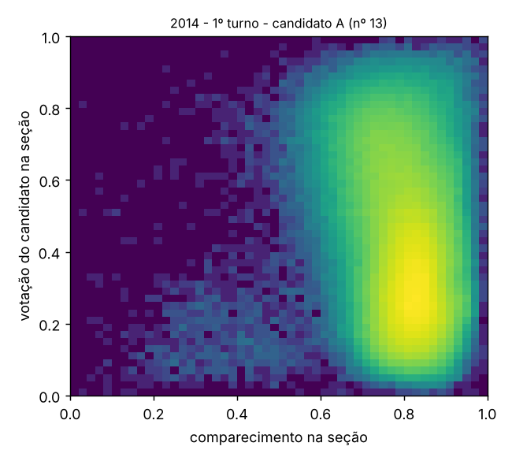

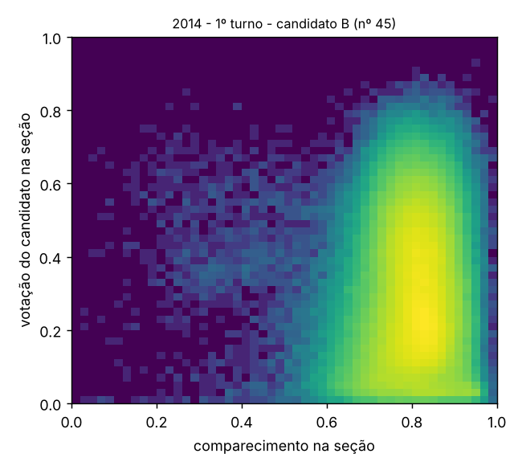

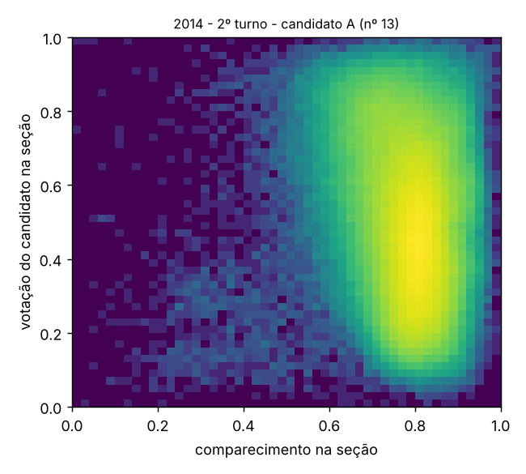

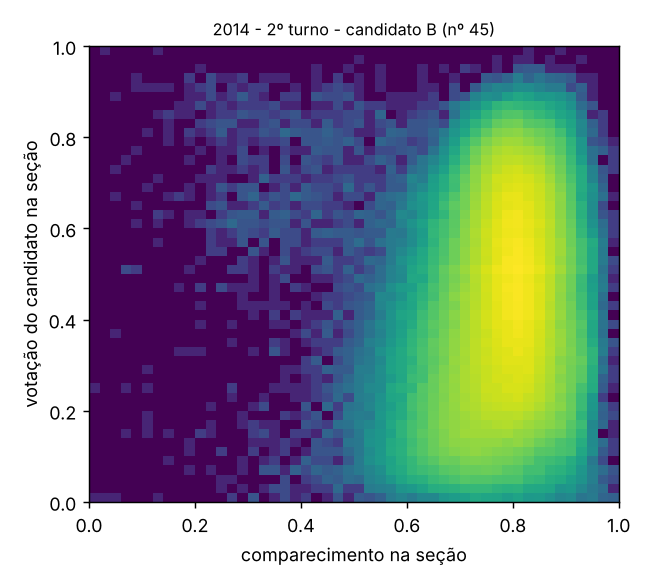

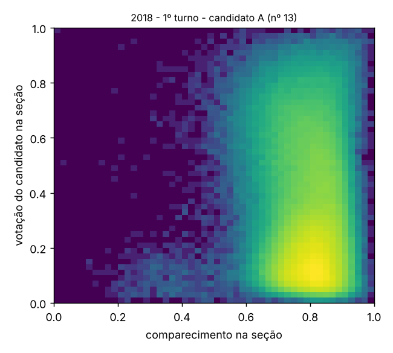

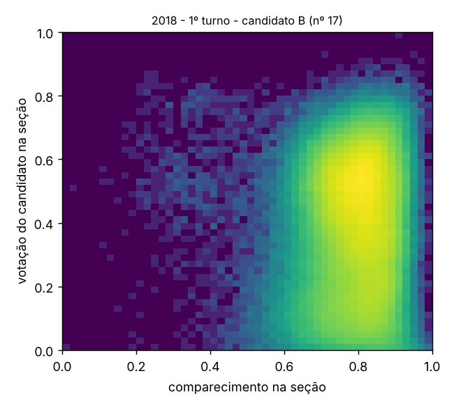

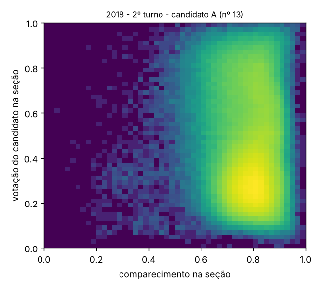

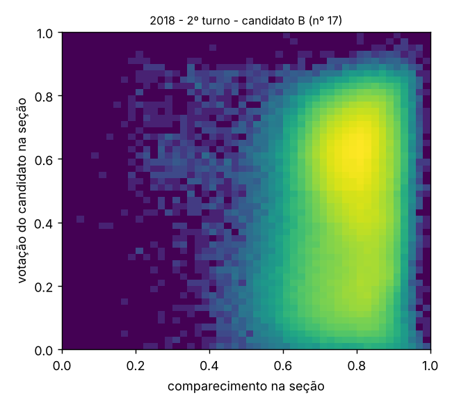

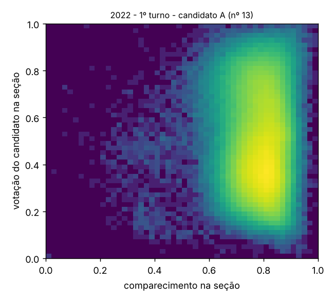

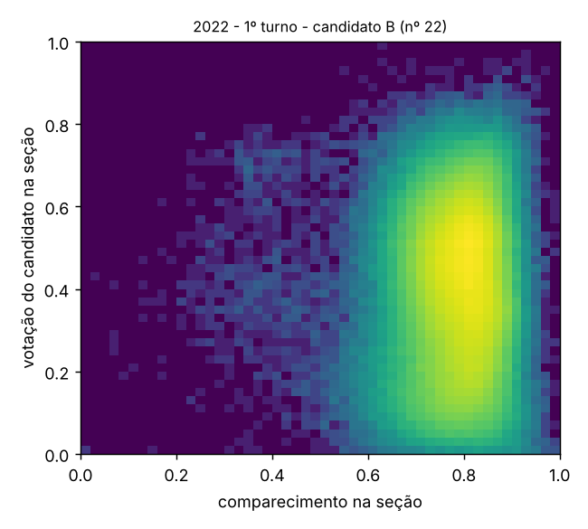

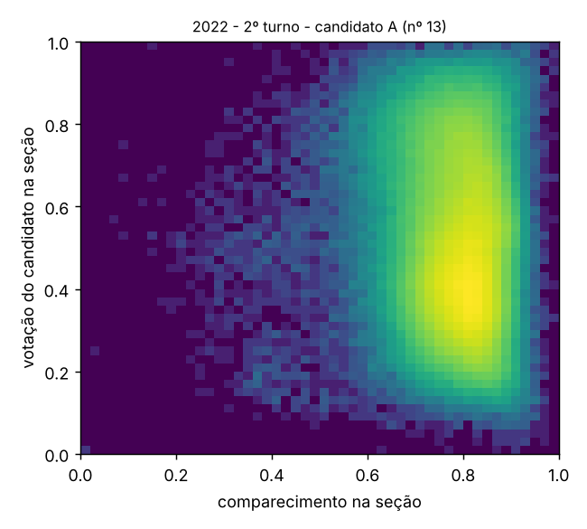

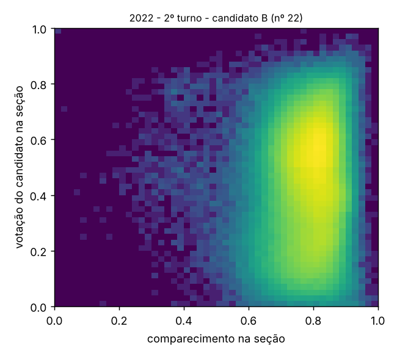

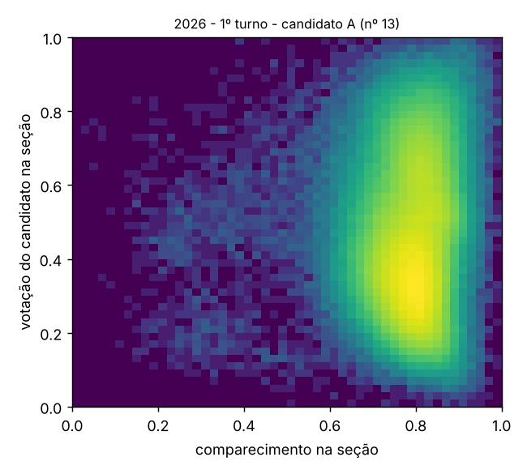

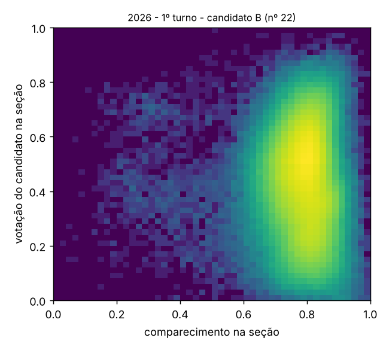

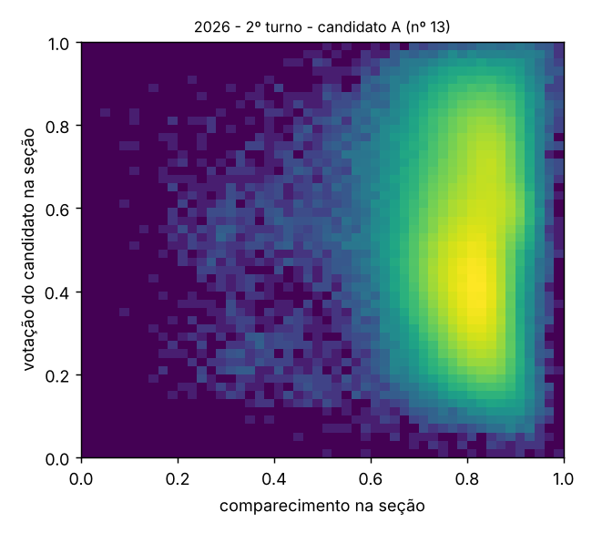

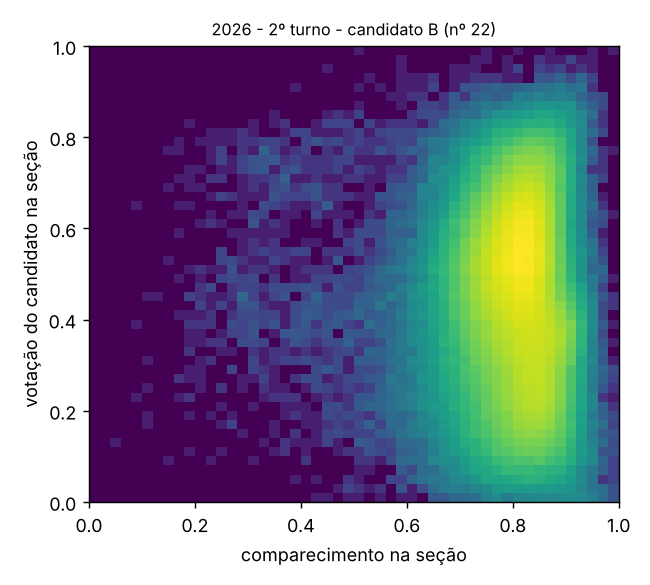
